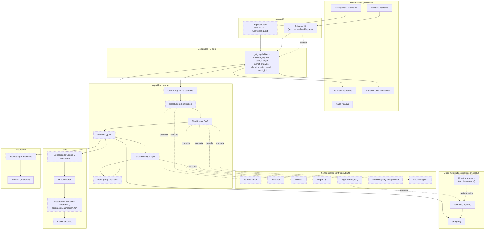
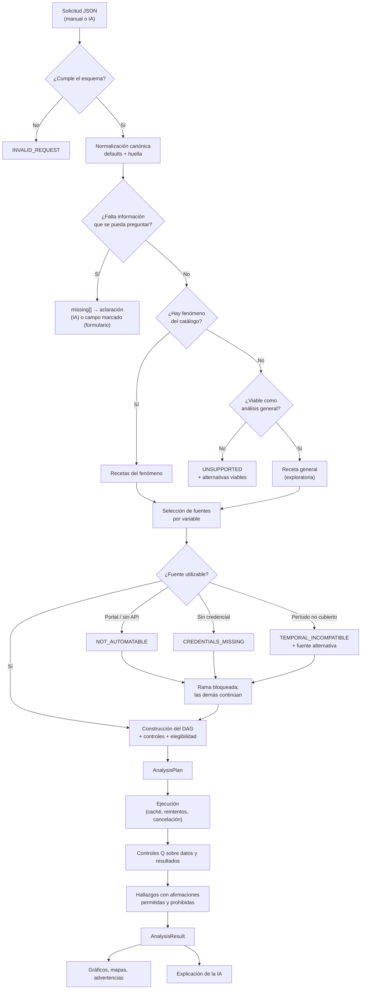
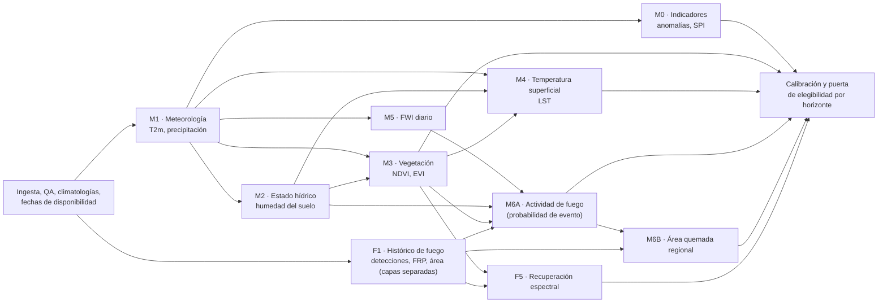
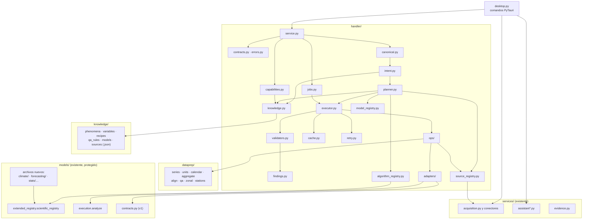
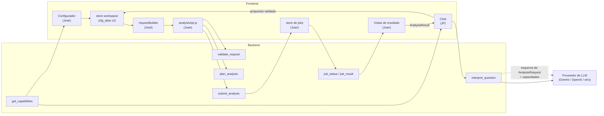
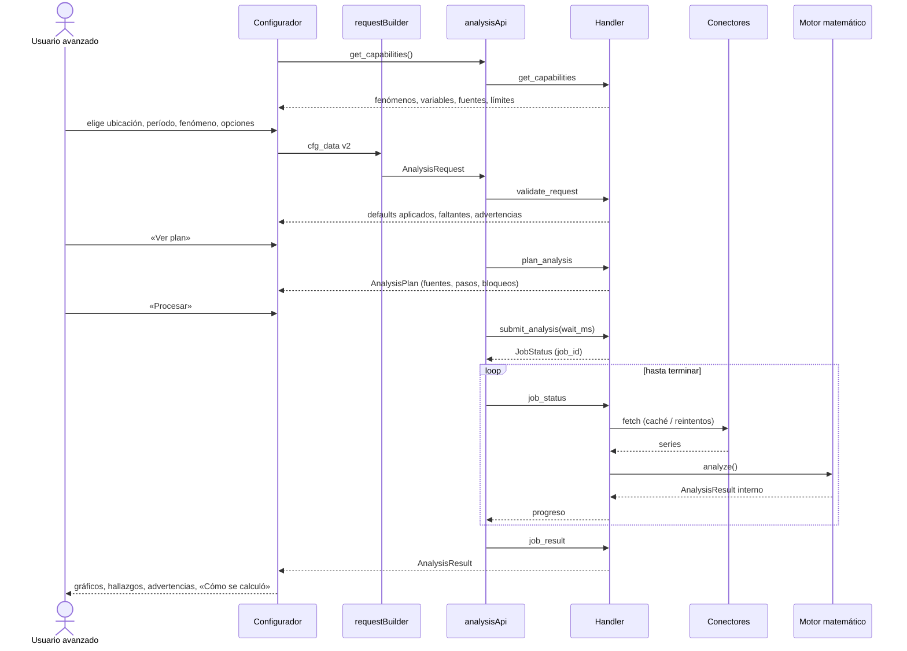
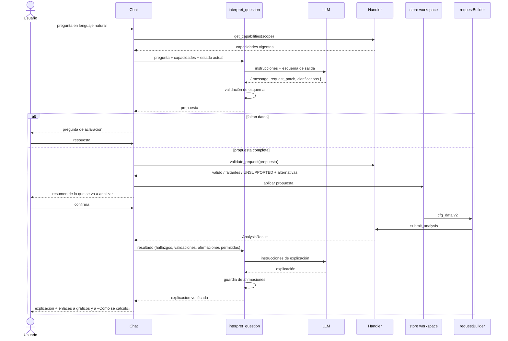
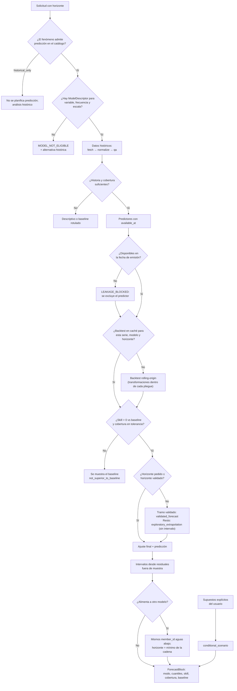
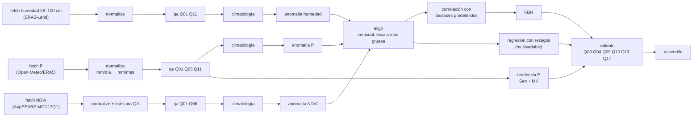

# 04 — Diagramas

Todos los diagramas están en Mermaid. Los componentes con borde punteado **no existen todavía**.

## D1 — Arquitectura general de componentes

## D2 — Flujo de una consulta

## D3 — Dependencias científicas (familias predictivas)

Sin ciclos: no hay realimentación fuego → clima. M3 y M4 no requieren ejecutar M5 ni M6B.

## D4 — Módulos del backend

Propiedad: **Ema** — `service`, `contracts`, `errors`, `canonical`, `knowledge`, `intent`, `planner`, `executor`, `validators`, `findings`, `capabilities`, `algorithm_registry`, `model_registry`, `adapters/`, y todo `models/`. **Eze** — `source_registry`, `jobs`, `cache`, `retry`, `dataprep/`, `services/` (conectores). **`ops/`** se reparte por archivo. **JP** — `services/assistant*.py` y `assistant-contract.json` (decisión D-15).

## D5 — Integración frontend / IA / backend

Punto clave: **el asistente y el formulario escriben en el mismo store**; la solicitud siempre la arma `requestBuilder`. La IA no tiene un camino propio hacia el backend.

## D6 — Secuencia: modo manual

## D7 — Secuencia: modo conversacional

## D8 — Ejecución predictiva

## D9 — DAG del Caso 2 (precipitación, humedad del suelo y NDVI)

Ilustra reutilización de nodos y ramas independientes.

El nodo de precipitación se descarga **una vez** y alimenta la tendencia y la asociación. Si falla NDVI, la rama de tendencia de precipitación igual se completa y el resultado es `partial`; el planificador genera además un nodo `align` por cada subconjunto de variables que la receta declare analizable por separado (aquí, precipitación–humedad), de modo que esa asociación no dependa de NDVI.
