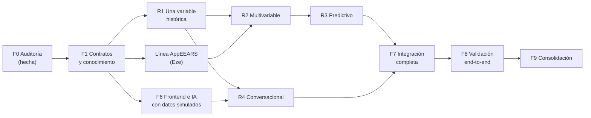

# 12 — Roadmap técnico

Sin fechas ni estimaciones de horas: el orden lo fijan las dependencias. Los identificadores de tarea remiten a los backlogs individuales (`13`–`17`).

## 1. Revisión del orden propuesto

El pedido proponía nueve fases secuenciales. La auditoría obliga a tres ajustes:

| Ajuste | Motivo |
|---|---|
| **Los contratos se congelan antes que cualquier otra cosa** y habilitan el trabajo en paralelo de los dos equipos | El frontend y la IA no dependen del backend sino de los contratos y los ejemplos fijos |
| **Las fases 2–5 se organizan por recorridos end-to-end**, no por capas | Evita módulos que solo se pueden probar al final |
| **El procesador de AppEEARS se adelanta** como línea propia de Eze, en paralelo con el recorrido 1 | Es el camino crítico: 7 de los 13 fenómenos MVP dependen por completo de él |

## 2. Fases

### Fase 0 — Auditoría ✔

**Entregable:** `02_AUDITORIA.md`, `06`, `07` y este plan.
**Criterio de salida:** los cinco integrantes leyeron el índice y las decisiones pendientes.

### Fase 1 — Arquitectura, contratos y conocimiento

**Objetivo:** que los dos equipos puedan trabajar sin bloquearse.

| Tarea | Responsable |
|---|---|
| Resolver las decisiones bloqueantes D-01, D-04, D-06, D-15 (ver `21`) | Los cinco |
| EMA-01 contratos Pydantic + JSON Schema + ejemplos fijos | Ema |
| EMA-02 forma canónica y huella | Ema |
| EMA-03 `phenomena.json` (73) · EMA-04 `variables.json` | Ema (+ ingeniera química) |
| EZE-01 `sources.json` · EZE-02 `NormalizedSeries` | Eze |
| EZE-18 CI de tests en la raíz | Eze |
| JUAN-01 cliente de API con modo simulado · JOSE-01 `requestBuilder` · JP-01 contrato del asistente v2 | Equipo IA/frontend |

**Criterio de salida:** los JSON Schema están publicados; los ejemplos de los 10 casos validan contra ellos en CI; `knowledge/` carga con las verificaciones de integridad (73 ids); los tres del frontend pueden ejecutar la interfaz contra datos simulados.

### Recorrido 1 — Una variable histórica (Fases 2 y 3 del pedido)

**Qué demuestra:** variable → fuente → preparación → algoritmo → resultado JSON → gráfico. Caso 1 (N1.1.0, rama T2m, NASA POWER).

| Backend | Frontend / IA |
|---|---|
| EMA-05 AlgorithmRegistry · EMA-06 adaptadores · EMA-07 intención y recetas (`R-TREND`, `R-DESCRIBE`) · EMA-08 planificador · EMA-09 ejecutor · EMA-10 validadores Q03/Q12 y hallazgos · EMA-11 comandos · EMA-27 capacidades · EMA-12 climatología · EMA-13 IC de Sen | JUAN-02 store de jobs · JUAN-03 despachador · JUAN-04 serie con tendencia · JUAN-08 estado de ejecución · JUAN-09 «Cómo se calculó» |
| EZE-03 aislamiento de fallos y reintentos · EZE-04 caché de series · EZE-05 JobManager · EZE-07 unidades · EZE-08 calendario y agregación · EZE-09 QA Q01/Q11 · EZE-10 selector de fuentes | JOSE-02 selector de fenómenos · JOSE-03 variables y fuentes · JOSE-06 validación en vivo y vista de plan · JOSE-07 errores |

**Criterio de salida:** el Caso 1 corre de punta a punta en la aplicación de escritorio con datos reales; T01 (tendencia no significativa) y T14 (unidades) pasan; el resultado incluye procedencia completa; la misma solicitud repetida da el mismo `plan_id` y usa la caché.

**Fenómenos habilitados:** N1.1.0 (T2m), N1.1A. Con muy poco trabajo adicional: N1.1.1 (océano).

### Línea AppEEARS (en paralelo desde la Fase 1)

| Tarea | Resultado |
|---|---|
| EZE-19 verificación en campo de credenciales | Se sabe qué conectores autenticados funcionan de verdad |
| EZE-12 AppEEARS por punto → serie con QA | NDVI, EVI, LST, ET real como series |
| EZE-13 AppEEARS por área → estadística zonal y área geodésica | LST por celda, área quemada, cobertura |

**Criterio de salida:** una serie de NDVI de MOD13Q1 con máscara QA y fracción de cobertura llega como `NormalizedSeries`; T06 pasa.

### Recorrido 2 — Varias variables (Fase 4)

**Qué demuestra:** varias variables → alineación → análisis multivariable → resultado. Empieza con **B3.5** (precipitación → SPI → humedad del suelo → nivel), que no depende de AppEEARS; sigue con **B2.2** (Caso 2) cuando haya NDVI.

| Backend | Frontend / IA |
|---|---|
| EMA-14 SPI · EMA-15 eventos · EMA-16 correlación con desfases y FDR · EMA-17 receta `R-LAGREG` · EMA-22 validadores Q04/Q13/Q17 · EMA-26 modalidad general | JUAN-05 multivariable (panel alineado, correlograma, dispersión) · JUAN-10 advertencias |
| EZE-06 selección de estaciones por puntaje · EZE-11 troceo de descargas largas · EZE-16 alineación (Q09/Q10) | JOSE-04 opciones científicas · JOSE-12 modos básico y avanzado |

**Criterio de salida:** Casos 2 y 9 corren; T02, T07, T09, T13 y T18 pasan; un fallo de una fuente produce resultado `partial`, no un error global.

**Fenómenos habilitados:** N1.2.0, N1.2C, N1.5.0, N1.5A, N1.5B, N1.9.0, B3.5; con AppEEARS: N1.3.0, N1.3B, B2.2.

### Ola de fuego y rejilla

| Backend | Frontend |
|---|---|
| EZE-14 FIRMS (caché, sensor, confianza; control Q07) · EZE-13 área quemada (control Q08) · EMA-23 recetas `R-COUNT` y `R-AREA` · EMA-24 semántica de fuego en hallazgos y control Q14 | JUAN-07 mapas con capas separadas |

**Criterio de salida:** Caso 4 corre; T03, T04, T19 y T20 pasan.

**Fenómenos habilitados:** N1.4.0, N1.4C, N1.1D, B9.1, B9.4; al final, B9.3.

### Recorrido 3 — Predictivo (Fase 5)

**Qué demuestra:** modelo → dependencias → validación → incertidumbre → visualización. Línea **PRED-03** (T2m mensual), la única sin bloqueos de datos.

| Backend | Frontend / IA |
|---|---|
| EMA-18 ModelRegistry y elegibilidad · EMA-19 baselines y backtesting · EMA-20 intervalos · EMA-21 `R-FORECAST` y `ForecastBlock` | JUAN-06 gráfico de abanico · JOSE-05 horizonte y modo · JP-05 explicación de pronósticos |

**Criterio de salida:** Caso 3 corre (para T2m; para NDVI cuando haya datos); T10 y T11 pasan; el resultado distingue los tres modos; ningún pronóstico se rotula `validated_forecast` sin `backtest_id`.

Después: PRED-01 (precipitación y SPI), PRED-02 (NDVI).

### Fase 6 — Frontend e IA (transversal desde la Fase 1)

No espera al backend. Hitos propios:

| Hito | Contenido |
|---|---|
| 6a | Interfaz completa contra datos simulados para los 10 casos |
| 6b | Asistente v2 generando solicitudes válidas contra capacidades simuladas; suite de comportamiento con proveedor simulado |
| 6c | Sustitución progresiva de simulaciones por comandos reales, recorrido por recorrido |

### Recorrido 4 — Conversacional

**Qué demuestra:** consulta → JSON → Handler → resultado → explicación. Requiere R1 y el hito 6b.

Tareas: JP-02 capacidades dinámicas · JP-03 intención · JP-04 aclaraciones · JP-05 explicación · JP-06 guardia de afirmaciones · JP-08 paridad · JOSE-09 propuesta del asistente en el formulario.

**Criterio de salida:** Casos 8 y 10 corren; T17 pasa (misma huella por ambos caminos).

### Fase 7 — Integración completa

Los cinco. Se retiran todas las simulaciones; se ejecutan los 10 casos con datos reales; `acquire_data` deja de usarse para análisis (decisión D-05); se resuelven las diferencias entre ejemplos fijos y respuestas reales.

**Criterio de salida:** los 10 casos pasan en la aplicación empaquetada, en al menos Windows.

### Fase 8 — Validación end-to-end

Matriz de aceptación completa (`19_PLAN_TESTING.md`): T01–T21, controles Q01–Q18, pruebas de fallos de fuentes, seguridad y paridad. Revisión científica de la ingeniera química sobre resultados reales del piloto.

**Criterio de salida:** las 21 pruebas en verde o con excepción documentada y aprobada.

### Fase 9 — Consolidación

Documentación de usuario y de desarrollo; actualización de `ENGINE_STATUS.md` y de los documentos desactualizados; retiro o archivo de código heredado según D-05; preparación de la integración a `main` (ver `20`).

---

## 3. Olas de fenómenos

| Ola | Qué habilita | Fenómenos | Depende de |
|---|---|---|---|
| **O1** | Tendencia univariable | N1.1.0 (T2m), N1.1A | R1 |
| **O2** | Series ya disponibles: lluvia, SPI, humedad, nivel, SST | N1.2.0, N1.2C, N1.5.0, N1.5A, N1.5B, N1.9.0, N1.1.1, B3.5 | R2 |
| **O3** | AppEEARS por punto | N1.3.0, N1.3B, N1.1.0 (LST), B2.2 | Línea AppEEARS |
| **O4** | Fuego y rejilla | N1.4.0, N1.4C, N1.1D, B9.1, B9.4, B9.3 | EZE-13, EZE-14 |
| **O5** | Predictivo | PRED-03, PRED-01, PRED-02 | R3 |
| **O6** | Segunda prioridad con algoritmos nuevos (extremos, pareados, eventos, FWI histórico) | N1.1B, N1.1C, N1.2A, N1.2B, N1.3C, N1.4A, N1.4B, N1.6.0, N1.6B, N1.9A, N1.9B, B2.6, B3.1, B5.3, B6.1, B9.2 | O1–O4 |
| **O7** | Tercera prioridad | Resto de L2 y L3 | O6 |
| **X** | Fuera de alcance v1: responden `UNSUPPORTED` o `NOT_AUTOMATABLE` con justificación | Los 17 de preparación L4 | — |

**Los 73 quedan contemplados desde la Fase 1**: todos están en `phenomena.json` con su estado, y `get_capabilities` informa su disponibilidad real. "Contemplado" no significa "ejecutable".

**MVP (13 fenómenos de la planilla):** se completa al cerrar O1–O4.

---

## 4. Estados de madurez y evidencia requerida

Un módulo no está terminado porque su código exista. Estados (extienden los del superprompt) y qué evidencia permite pasar a cada uno:

| Estado | Evidencia mínima | Quién lo certifica |
|---|---|---|
| **Especificado** | Entrada en `knowledge/` o en este plan, con entradas, salidas y restricciones | Autor |
| **Implementado** | Código integrado en una rama con PR abierto | Autor |
| **Probado unitariamente** | Tests con datos sintéticos y casos extremos en verde en CI | Revisor del PR |
| **Integrado** | Invocable desde el Handler; aparece en `get_capabilities`; test de integración en verde | Ema |
| **Fuente conectada** | Descarga real verificada, con fecha y alcance en `last_verified` del descriptor | Eze |
| **Validado matemáticamente** | Comparación contra una referencia independiente (biblioteca establecida, solución analítica o valores publicados), documentada junto al módulo | Ema + revisor distinto del autor |
| **Backtesteado** | `backtest_id` con rolling-origin, sin fuga, con baseline y métricas por horizonte | Ema |
| **Calibrado** | Cobertura empírica de intervalos (o fiabilidad de probabilidades) dentro de tolerancia en bloque disjunto | Ema |
| **Validado científicamente** | Revisión de resultados reales por la ingeniera química para ese fenómeno | Ingeniera química |
| **Validado para uso operacional** | **Fuera de alcance.** XURCA no es un sistema de alerta certificado | — |

Reglas:

- El estado se guarda en datos (`AlgorithmDescriptor.validation_state`, `ModelDescriptor.state`, `phenomena.implementation_state`, `DataSourceDescriptor.connection_state`) y lo expone `get_capabilities`. **No se declara en prosa.**
- Un fenómeno está **disponible** cuando: sus variables tienen fuente conectada, su receta está integrada, sus controles Q están implementados y su caso de aceptación pasa.
- Un pronóstico es `validated_forecast` solo desde "Backtesteado" con habilidad positiva; los intervalos nominales, solo desde "Calibrado".

---

## 5. Dependencias críticas (qué bloquea a qué)

| Bloqueante | Bloquea | Mitigación |
|---|---|---|
| EMA-01 contratos | Todo el equipo IA/frontend y EZE-02 | Primera tarea; revisión conjunta; ejemplos fijos |
| EMA-03 `phenomena.json` | Intención, capacidades, selector de fenómenos, IA | Empezar por los 13 MVP completos y el resto con texto de planilla |
| EZE-02 `NormalizedSeries` | Adaptador al motor, `dataprep/`, caché | Definirla junto con EMA-01 |
| EZE-05 JobManager | `submit_analysis`, estado de ejecución en la interfaz | La interfaz usa la simulación mientras tanto |
| EZE-12 / EZE-13 AppEEARS | 7 fenómenos MVP completos y 2 parciales; PRED-02 | Línea paralela desde la Fase 1; verificación temprana de credenciales (EZE-19) |
| D-06 dependencias opcionales | `stl`, `pelt`, `sarima`, MK modificado en la aplicación empaquetada | Decidir en la Fase 1 |
| D-03 umbrales científicos | Estados "validado"; valores por defecto de desfases y mínimos | Se trabaja con valores `proposed` visibles como tales |
| Ingeniera química | Revisión de `phenomena.json` y validación científica | Revisiones por ola, no al final |

## 6. Trabajo en paralelo

| Simultáneo sin conflicto | Requiere contrato previo | Requiere colaboración estrecha |
|---|---|---|
| Algoritmos nuevos (Ema) y conectores (Eze) | Todo lo de frontend/IA ↔ EMA-01 | Ejecutor (Ema) + JobManager y caché (Eze) |
| Vistas de resultado (Juan) y configurador (José) | `dataprep/` ↔ EZE-02 | `ops/` del DAG (Ema + Eze) |
| Asistente (JP) y vistas (Juan) | Asistente ↔ esquema de capacidades | Paridad T17 (JP + José + Ema) |
| Línea AppEEARS (Eze) y recorrido 1 (Ema) | | `qa_rules.json` (Ema + Eze) |

**Zonas de conflicto de archivos** (ver `18` y `20`): `PY/desktop.py`, `handler/ops/`, `TS/src/routes/+page.svelte`, `Settings.svelte`, `stores/workspace.js`, `services/i18n.js`.
